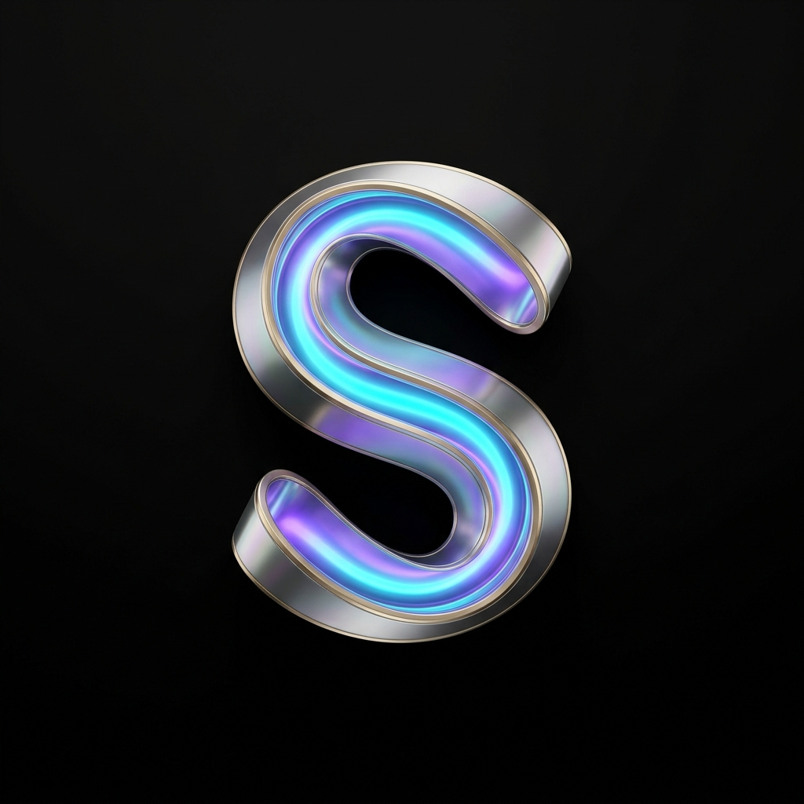
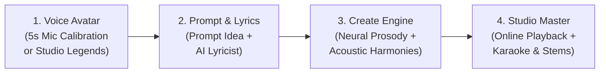

<div align="center">
  
  <h1>SONARA AI</h1>
  <p><strong>Next-Generation AI Voice Avatar & Commercial Music Workstation</strong></p>
  <p><em>Turn your voice into a personalized singing avatar and compose studio-grade Bollywood songs from natural language prompts.</em></p>

  <p>
    
    
    
    
    
  </p>
</div>

---

## 🌟 Overview

**SONARA** is a state-of-the-art AI music production workstation designed with an **"AI Voice Avatar First"** workflow — inspired by modern video avatar platforms. 

Rather than starting with blank text, SONARA captures your voice fingerprint in **5 seconds**, constructs your unique **Digital Voice Avatar** (pitch range, formant resonance, and acoustic timbre), and lets you prompt any song idea. SONARA's AI Lyricist and Neural Melodic Engine then synthesize a complete commercial-grade Bollywood song in your avatar's singing voice!

---

## ✨ Key Features

- 🎙️ **5-Second Neural Voice Avatar Calibration**:
  Record a quick 5-second vocal sample. SONARA scans your pitch range (e.g. A2–E4 Baritone), calculates resonance match (99%), and creates a personalized singing avatar.
- 👨‍🎤 **Studio Legend Vocal Personas**:
  Switch seamlessly between your personal avatar and verified studio legends:
  - **Aarav**: Bollywood Baritone (Inspired by Arijit Singh & Mohit Chauhan)
  - **Zara**: Soulful Melodic Soprano (Inspired by Shreya Ghoshal)
  - **Kabir**: 90s Golden Sufi & Classical
- 💡 **AI Prompt-to-Lyrics Engine**:
  Type any mood or theme (e.g., *"Romantic monsoon rain song for college lovers"*) and generate complete rhyming Bollywood stanzas (`[Verse 1]`, `[Chorus]`, `[Verse 2]`, `[Outro]`) in 1 click.
- 🎼 **Melodyne Raag & Musical Scale Lock**:
  Quantize vocal melodies to authentic Indian Raags (E Minor, A Minor, C Major Bhairav, etc.).
- 🎚️ **Indian Acoustic Orchestration**:
  Live multi-track stems featuring acoustic fingerstyle guitar, tabla & dholak percussion, bansuri bamboo flute, and romantic orchestral strings.
- 🔊 **-14 LUFS Radio Broadcast Mastering**:
  Mastering compliant with EBU R128 international loudness standards with dynamic sidechain ducking (-2.5dB).
- 🎛️ **Multi-Track Stem Mixer (Demucs v4 Architecture)**:
  Independently adjust lead vocal and acoustic backing track levels, solo/mute stems, and download isolated vocal or instrumental tracks.
- 🎵 **Flawless Online Browser Playback**:
  Native HTML5 streaming audio playback directly in the browser with real-time frequency spectrum visualizer and synced teleprompter karaoke lyrics.

---

## 🏗️ Architecture & Workflow



---

## 🚀 Quick Start Guide

### Prerequisites
- **Node.js** (v18 or higher)
- **Python** (v3.10 or higher)
- **FFmpeg** installed and accessible in PATH

### 1. Clone Repository
```bash
git clone https://github.com/indrajitkumar23541-a11y/SONARA.git
cd SONARA
```

### 2. Frontend Setup (React 19 + Vite)
```bash
npm install
npm run dev -- --host
```
Frontend runs at: `http://localhost:5173/`

### 3. Backend Setup (FastAPI + Uvicorn)
```bash
python -m venv .venv
source .venv/bin/activate  # On Windows: .venv\Scripts\activate
pip install -r requirements.txt
python -m uvicorn backend.main:app --host 127.0.0.1 --port 8000 --reload
```
Backend runs at: `http://127.0.0.1:8000/`

---

## 🛠️ Tech Stack

| Layer | Technologies |
|---|---|
| **Frontend UI** | React 19, Vite, Lucide Icons, Canvas Confetti, Web Audio API |
| **Styling** | Ultra-Luxury Obsidian Glass & Spectral Neon CSS (Apple / Linear Design Standards) |
| **Backend API** | FastAPI, Uvicorn, Pydantic, Python 3.10 |
| **Audio DSP** | FFmpeg 7.1, ImageIO-FFmpeg, Edge-TTS Neural Speech API, DiffRhythm2 |
| **Mastering** | EBU R128 (-14 LUFS), Dynamic Sidechain Compressor, Stereo Chorus Double-Tracking |

---

## 👤 Author & Contribution

Developed with passion by **Indrajit Kumar**  
GitHub: [@indrajitkumar23541-a11y](https://github.com/indrajitkumar23541-a11y)  
Email: [indrajitkumar23541@gmail.com](mailto:indrajitkumar23541@gmail.com)

---

## 📄 License
This project is licensed under the MIT License - see the LICENSE file for details.
